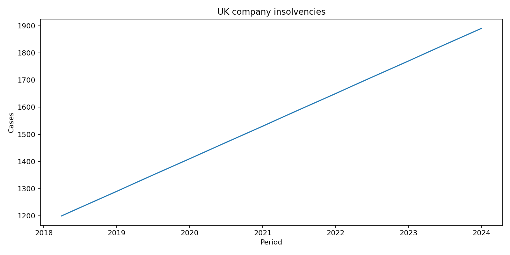
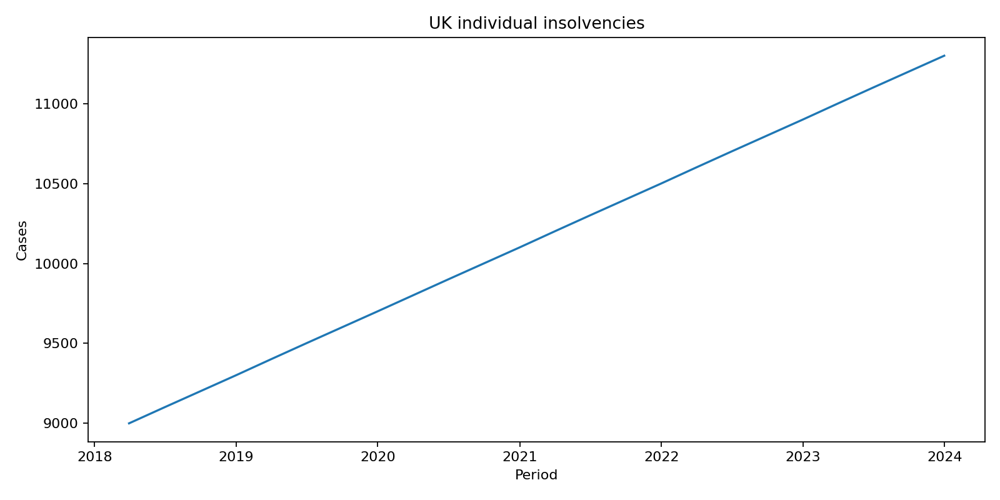

# Macro Risk RAG Agent

## Objective

Macroeconomic research is valuable only when analysts can retrieve evidence quickly and cite it. This retrieval-augmented agent ingests financial PDFs, retrieves relevant passages and produces source-aware answers for risk committees, portfolio managers and scenario teams. The project focuses on evidence traceability: generated analysis should remain anchored to the documents supplied to the system.

## Architecture

```text
Macro-Risk-RAG-Agent/
├── assets/
│   └── charts/                         # Insolvency trend visuals
├── data/                               # Government extracts and vector-store data
├── docs/
│   ├── GenAI Financial Analyst - Technical Guide.pdf
│   └── Macro Risk AI Agent - Deployment Guide.pdf
├── infrastructure/
│   ├── Dockerfile
│   └── docker/analyst
├── notebooks/
│   └── Macro_Risk_Analyst.ipynb
├── src/
│   ├── rag_ingest.py                   # PDF extraction and vector indexing
│   ├── rag_agent.py                    # Retrieval, prompting and citations
│   └── generate_charts.py              # Insolvency trend charts
└── tests/
```

## Quickstart

```bash
pip install -r requirements.txt
python src/rag_ingest.py
python src/rag_agent.py
python -m src.generate_charts
```

The public insolvency extracts and vector-store database are retained under `data/` for local analysis.



Company insolvency trends provide a measurable macro-risk transmission channel from rates and demand into credit losses. Keeping the source series visible alongside the RAG workflow supports challenge, provenance review and separation of retrieved evidence from generated interpretation.



Individual insolvency trends add household stress to the same decision frame. Comparing the two series helps analysts separate corporate and consumer deterioration, improving scenario design while preserving a clear audit trail for the evidence behind the narrative.
