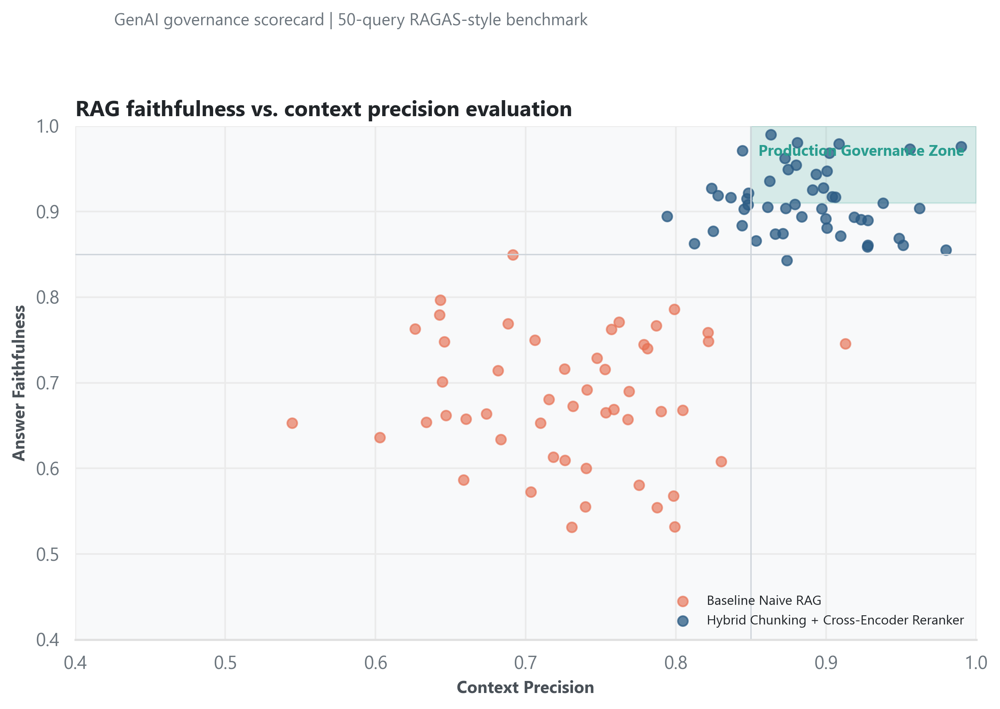
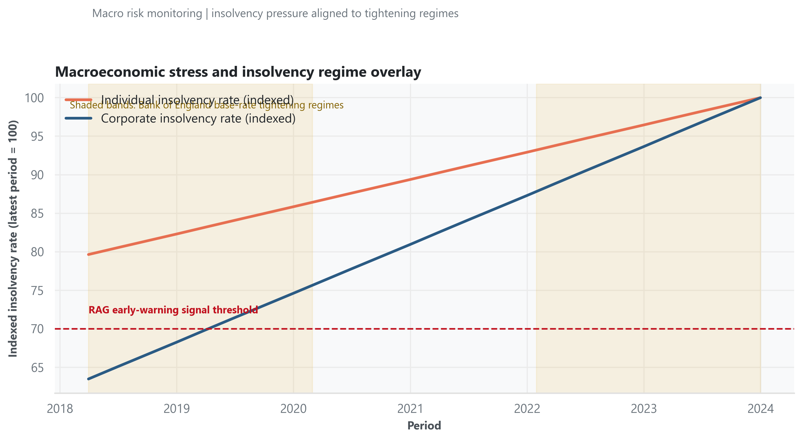

# Macro Risk RAG Agent

## Objective

Macroeconomic research is valuable only when analysts can retrieve evidence quickly and cite it. This retrieval-augmented agent ingests financial PDFs, retrieves relevant passages and produces source-aware answers for risk committees, portfolio managers and scenario teams. The project focuses on evidence traceability: generated analysis should remain anchored to the documents supplied to the system.

## Architecture

```text
Macro-Risk-RAG-Agent/
├── assets/
│   └── charts/                         # RAG governance and macro-risk visuals
├── data/                               # Government extracts and vector-store data
├── docs/
│   ├── GenAI Financial Analyst - Technical Guide.pdf
│   └── Macro Risk AI Agent - Deployment Guide.pdf
├── infrastructure/
│   ├── Dockerfile
│   └── docker/analyst
├── notebooks/
│   └── Macro_Risk_Analyst.ipynb
├── src/
│   ├── rag_ingest.py                   # PDF extraction and vector indexing
│   ├── rag_agent.py                    # Retrieval, prompting and citations
│   └── generate_charts.py              # Insolvency trend charts
└── tests/
```

## Quickstart

```bash
pip install -r requirements.txt
python src/rag_ingest.py
python src/rag_agent.py
python -m src.generate_charts
```

The public insolvency extracts and vector-store database are retained under `data/` for local analysis.



The RAGAS-style benchmark compares baseline and hybrid retrieval across 50 test queries, with the top-right shaded region identifying the production governance zone.



The macro overlay compares indexed corporate and individual insolvency pressure with shaded Bank of England tightening regimes and the RAG early-warning threshold.
